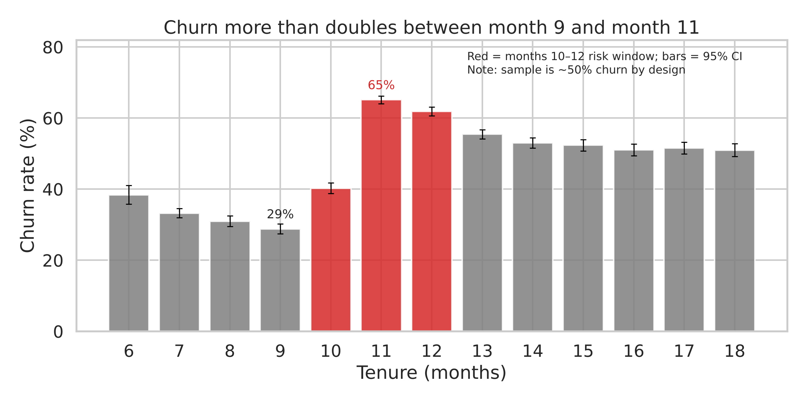
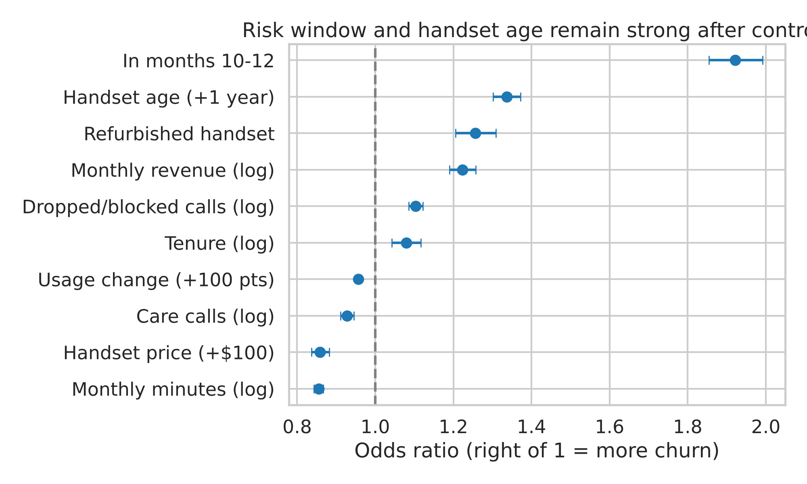
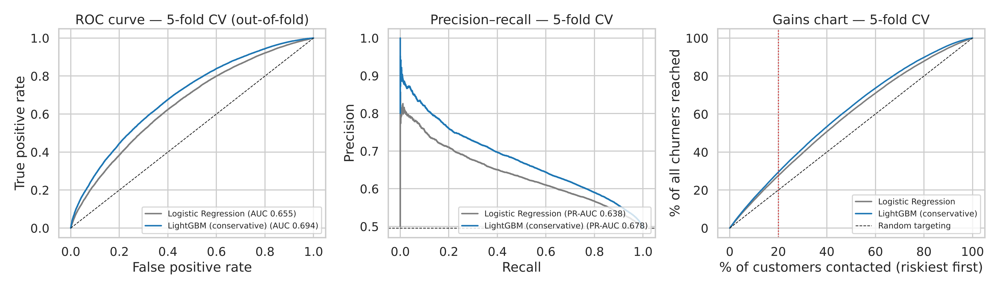
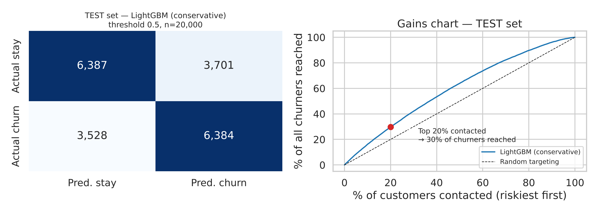
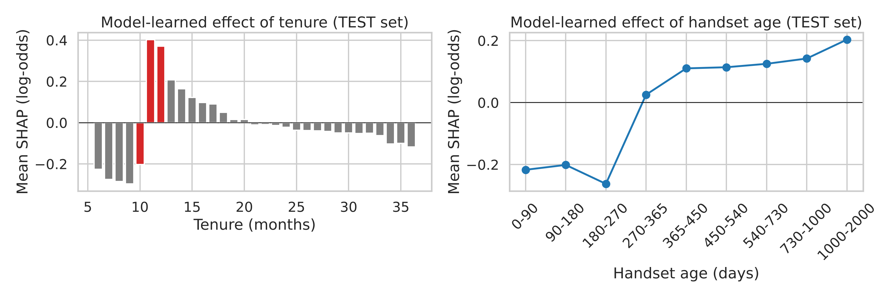
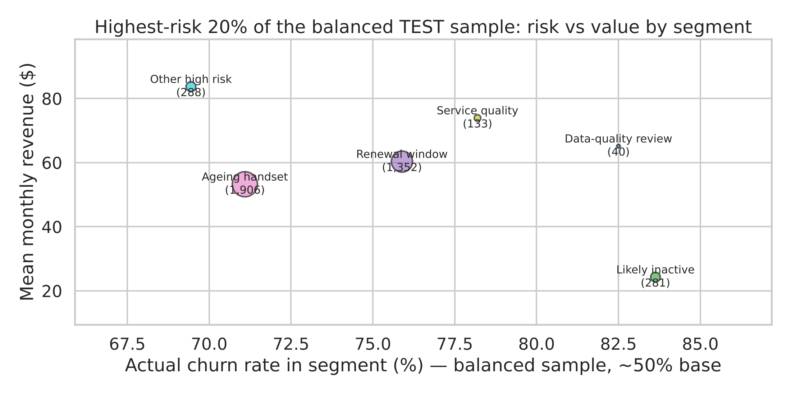
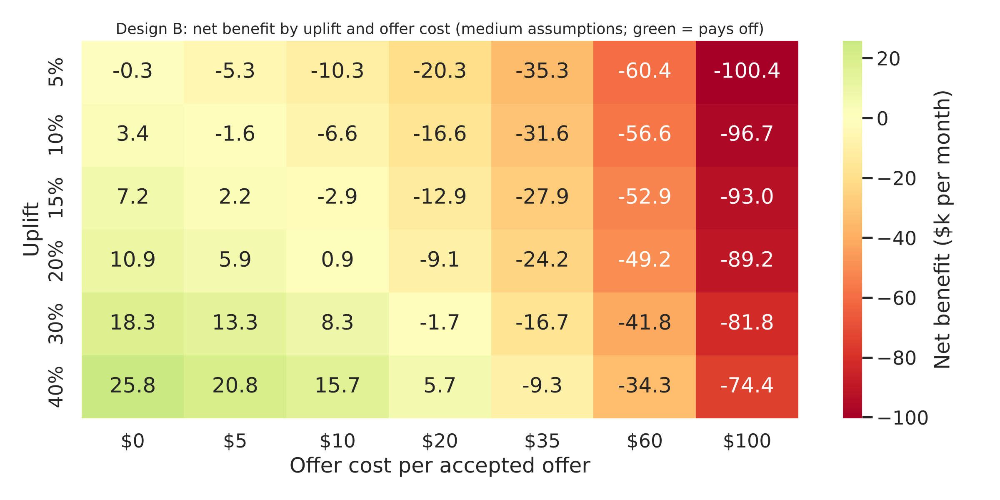

# Telecom Customer Churn Prediction & Retention Strategy

   

An end-to-end data science project that uses customer data and machine learning to identify telecom customers at risk of churning — and then asks the harder business question: **when does a retention programme actually pay off?**

The project goes beyond model accuracy: it validates hypotheses statistically, explains the model with SHAP, calibrates probabilities to realistic churn rates, builds a transparent break-even financial model, and designs a randomised pilot to measure whether retention actions really change customer behaviour.

> **Scope.** Analytical case study on an anonymised telecom dataset ("Company A"). Company A is not an identified real operator, and nothing here was deployed in production. Financial figures are **scenarios**, not proven business impact.

📄 [Report (PDF)](reports/telecom_churn_report.pdf) · 📊 [Presentation (PPTX)](reports/presentation.pptx) · 📓 [Notebook](notebooks/telecom_churn_analysis.ipynb) · 📐 [Methodology](docs/methodology.md)

---

## Results at a glance

| | |
|---|---|
| **Key insight** | Churn rises from **28.8%** at tenure month 9 to **65.1%** at month 11 (non-overlapping 95% CIs) |
| **Selected model** | LightGBM — **test ROC-AUC 0.695**, top-20% lift **1.49×** |
| **Rejected strategy** | A $60 discount to every flagged customer: **−$328,445** per monthly campaign (break-even uplift 214% — impossible) |
| **Proposed strategy** | Value-focused, low-cost actions: break-even at **18.8% uplift** — to be tested in a randomised pilot |

Labels used below: **[D]** observed dataset finding · **[B]** external benchmark · **[A]** scenario assumption.

---

## 1. Project Overview
Customer churn is one of the most expensive problems in subscription businesses. This project analyses ~100,000 customers of an anonymised telecom operator to (1) find *when* and *why* churn risk rises, (2) predict *who* is likely to leave in the next 31–60 days, and (3) evaluate *whether* acting on those predictions can be profitable.

## 2. Business Problem
The operator has rich customer data but no systematic way to use it for retention. A naïve approach — "predict churners and give them discounts" — sounds reasonable but can destroy value, because most customers flagged by any model would have stayed anyway. The real problem is deciding **who to contact, when, with what action, and at what cost**.

## 3. Project Objectives
- Identify the main churn risk patterns in the data and test them statistically.
- Build and fairly compare machine-learning models for churn prediction.
- Explain predictions in business terms and segment high-risk customers by cause and value.
- Quantify the financial feasibility of retention strategies under transparent assumptions.
- Design a randomised pilot that can verify the strategy before it is scaled.

## 4. Dataset Description
| Item | Detail |
|---|---|
| Source | Anonymised telecom operator; two tables joined 1:1 on `Customer_ID` |
| Size | 100,000 customers, ~100 variables (usage, billing, call quality, handset, account, household) |
| Target | `churn` = customer left **31–60 days after the snapshot** — a realistic intervention window |
| Balance | **49.6% churners by design** — not the real-world churn rate |
| Availability | Not redistributed — see [`data/README.md`](data/README.md) |

## 5. Project Workflow
```
Explore → Validate hypotheses → Prepare data → Model & compare → Explain (SHAP) → Segment → Calibrate → Financial scenarios → Pilot design
```

## 6. Exploratory Data Analysis
**[D] Churn risk jumps around month 11 of tenure.** Churn falls to its lowest at month 9 (28.8%, 95% CI 27.4%–30.2%), then jumps to 65.1% at month 11 (95% CI 64.1%–66.2%), and settles around 51–55% afterwards — a step up, not a temporary spike.



**[D] The pattern survives statistical controls.** In a logistic regression controlling for handset price, revenue, usage, usage change, care calls, call failures and refurbished handsets, being in months 10–12 multiplies the odds of churn by **1.92** (stable as controls are added: 1.87 → 1.89 → 1.92); each extra year of handset age multiplies them by **1.34**.



> These are **associations, not causes**. The data has no contract field, so months 10–12 are an observed *risk window* — consistent with, but not proof of, contract expiry.

## 7. Feature Engineering and Preprocessing
- **Leakage review:** every feature checked for availability at the prediction date; the strongest single feature reaches only ROC-AUC 0.57, so no feature "leaks" the answer.
- **Data quality:** impossible handset ages set to missing; protected attribute (`ethnic`) and >30%-missing household columns removed.
- **Missing usage ≠ inactivity:** 357 customers lack a whole usage block but show normal recent revenue — treated as a **data-quality issue**, flagged, and never labelled inactive.
- **Engineered features:** risk-window flag, handset age ÷ tenure (original phone vs upgraded), dropped-call rate, revenue per minute, zero-usage and refurbished flags.
- **No preprocessing leakage:** clipping, imputation, scaling and encoding are fitted inside each training fold.

## 8. Machine Learning Models
| Model | CV ROC-AUC | Train–validation gap | Top-20% lift |
|---|---|---|---|
| Logistic Regression (baseline) | 0.655 | 0.005 | 1.38× |
| LightGBM (default) | 0.695 | 0.112 | 1.47× |
| **LightGBM (conservative) — selected** | **0.694 ± 0.004** | **0.067** | **1.47×** |

LightGBM beat Logistic Regression in all five folds. The conservative version matched the default's validation performance with about half the overfitting gap — when performance is equal, the simpler model wins.



## 9. Model Evaluation and Results
Final model, evaluated **once** on 20,000 held-out customers:

| Metric | Test | What it means for the business |
|---|---|---|
| ROC-AUC | **0.695** | 69% of the time, the model ranks a real leaver above a stayer (0.5 = coin flip) |
| PR-AUC | **0.683** | How clean the contact list stays as it grows |
| F1-score (threshold 0.5) | **0.638** | Balance of catching churners and avoiding false alarms at one cut-off |
| Precision, riskiest 20% | **73.8%** | Share of contacted customers who really churn *(balanced sample — much lower at real churn rates)* |
| Recall, riskiest 20% | **29.8%** | Share of all churners the top-20% list reaches |
| Lift, riskiest 20% | **1.49×** | The list holds 1.49× more churners than a random list of the same size |

Test results match cross-validation (CV ROC-AUC 0.694 ± 0.004), so the model did not overfit. Actual churn falls from **80%** in the riskiest tenth of customers to **19%** in the safest. A ROC-AUC near 0.7 is moderate — the model's value lies in **ranking** customers for a limited budget, not in confident individual predictions.



**Explainability (SHAP).** Top drivers: handset age (days), change in minutes vs 3-mo avg, tenure (months), revenue per minute. The model independently rediscovered the month-11 risk spike and a jump once handsets pass about one year.



## 10. Churn Risk Segmentation
[D] Highest-risk 20% of the balanced test sample (sample churn rates — compare groups, not levels):

| Segment | Customers | Sample churn | Mean monthly revenue |
|---|---|---|---|
| Data-quality review | 40 | 82.5% | $65 |
| Likely inactive | 281 | 83.6% | $24 |
| Renewal window | 1,352 | 75.9% | $60 |
| Ageing handset | 1,906 | 71.1% | $53 |
| Service quality | 133 | 78.2% | $74 |
| Other high risk | 288 | 69.4% | $84 |

Risk is not value: the riskiest group (zero usage) brings the least revenue, while smaller groups carry the most. Each segment needs a different action — not one discount.



## 11. Business Retention Strategy
**Rejected — Design A (blanket discount).** A $60 offer to every customer above a risk cut-off: of 10,767 customers contacted per 100,000, only 596 would actually leave (5.5%). Net **−$328,445** per monthly campaign, ROI -95%, break-even uplift 214% — impossible.

**Proposed — Design B (value-focused, low-cost, test-first).**
1. Score all customers monthly.
2. **Calibrate** probabilities from the 50% sample to the assumed real churn rate (prior-shift adjustment).
3. Rank by **calibrated risk × monthly revenue** and select the top 2% (≈2,002 customers per 100,000).
4. Route by segment: pre-renewal outreach at months 9–10, customer-financed handset upgrade with a new commitment, service fixes — not blanket discounts.
5. Measure every action against a randomised control group.

## 12. Financial Impact and Scenario Analysis
All figures are **[A] scenario assumptions** per monthly campaign and 100,000 customers: 2% monthly churn (benchmark-anchored), 45% contribution margin [B], 50% acceptance, $2 contact cost, 12-month value horizon. Benefit counts **contribution margin of incremental saves only**.

| | Design A | Design B |
|---|---|---|
| Customers contacted | 10,767 | 2,002 |
| Value of one saved customer | $270 | $688 |
| Cost per accepted offer | $60 | $10 |
| Break-even uplift | 214% | **18.8%** |

- Break-even uplift for Design B by churn scenario: 14.6% (2.7%), 18.8% (2%), 35.2% (1%).
- Historical credits ($35–60) would need 52%–86% uplift even on the value-focused list.
- **Illustrative, marginal scenario — not a guaranteed result:** at 20% uplift and a $10 action, Design B nets **$865 per monthly campaign** (ROI 6%) — essentially break-even. At 30% uplift it would be +$8.3k. Whether such uplift is achievable is unknown until the pilot measures it.



[B] Context: US postpaid phone churn is ~0.9–1.1% per month today [2][3]; a carrier with the same data design reported ~1.8% [1]. At a constant 2% monthly churn, about 21.5% of customers leave per year.

## 13. Pilot Experiment and Validation Plan
- **Randomised treatment/control split**; churn measured for **both groups over the same 31–60-day window**.
- **Uplift** = (control churn − treatment churn) ÷ control churn, counting everyone randomised. **Acceptance** (acceptors ÷ offered) is measured separately and drives cost.
- **Complier-effect estimate** = churn reduction ÷ acceptance — valid only under random assignment, no offer in control, and an offer that works only through acceptance.
- **Size:** 5,952 customers per group to detect a 20% uplift on a top-10% risk list (≈1.2 months); the narrower value list would need ≈6 months. The broader list measures uplift; the value list is the scale-up strategy.
- **Decision rule:** scale only actions whose measured uplift beats their break-even uplift, and check the effect holds for high-value segments.

## 14. Key Insights
1. Churn risk is **time-dependent**: it steps up sharply around months 10–12 of tenure.
2. Handset age, refurbished handsets and call failures add independent risk; pricier handsets are linked to lower risk.
3. A moderate model (ROC-AUC ≈ 0.7) is still valuable for **ranking** — but a risk score alone does not justify spending.
4. Blanket discounts fail because, at realistic churn rates, ~94% of a flagged list would have stayed anyway.
5. **Calibration matters for value-based targeting:** it barely changes who is "risky" but changes who is "worth saving".
6. The decisive unknown is **uplift** — only a randomised pilot can measure it.

## 15. Limitations and Assumptions
- **Balanced sample:** probabilities are re-calibrated by a prior-shift assumption, not verified on a representative customer sample. Real calibration needs recent, unbalanced data with observed outcomes.
- **No time-based validation:** the data has no date column.
- **Observational data:** all findings are associations; the cause of the month-11 step is unknown.
- **Assumptions [A]:** uplift, acceptance, contact cost and value horizon are illustrative; acceptance among would-be churners is unknown.
- **Benchmarks [B]:** offer-cost (2003) and same-design churn (2006) sources are old; one churn figure comes from a press-release reproduction.

## 16. Technologies Used
Python · pandas · NumPy · SciPy · statsmodels · scikit-learn · LightGBM · SHAP · Matplotlib · seaborn · Jupyter

## 17. Repository Structure
```
telecom-churn-prediction-retention-strategy/
├── README.md
├── LICENSE
├── requirements.txt
├── .gitignore
├── data/                 # place Client.csv and Record.csv here (not included)
│   └── README.md
├── notebooks/
│   └── telecom_churn_analysis.ipynb   # full, executed analysis
├── reports/
│   ├── telecom_churn_report.pdf       # 15-slide report
│   └── presentation.pptx              # editable version
├── results/              # metrics.json + summary tables written by the notebook
├── visuals/              # charts written by the notebook
├── docs/
│   └── methodology.md
└── references/
    └── references.md
```

## 18. Installation and Setup
```bash
git clone https://github.com/YOUR_USERNAME/telecom-churn-prediction-retention-strategy.git
cd telecom-churn-prediction-retention-strategy

python -m venv venv
# Windows (PowerShell / Command Prompt)
venv\Scripts\activate
# macOS / Linux
source venv/bin/activate

pip install -r requirements.txt
```
Then place `Client.csv` and `Record.csv` in `data/` (see [`data/README.md`](data/README.md)).

## 19. How to Run the Project
```bash
jupyter notebook notebooks/telecom_churn_analysis.ipynb
```
Run all cells (about 5–10 minutes on a CPU). Or execute it headlessly from the repository root:
```bash
jupyter nbconvert --to notebook --execute --inplace notebooks/telecom_churn_analysis.ipynb
```
The notebook writes charts to `visuals/` and metrics to `results/metrics.json`. All randomness uses seed 42.

## 20. Future Improvements
- Calibrate and validate the model out-of-time on a recent, representative (unbalanced) customer sample.
- Run the randomised pilot and build an **uplift (treatment-response) model** from its results.
- Add time-aware validation and drift monitoring for monthly scoring.
- Extend the financial model to full customer lifetime value with discounting.
- Package scoring as a reproducible pipeline (e.g. scheduled batch job).

## 21. References
See [`references/references.md`](references/references.md). Key sources: Lemmens & Croux (2006), *Journal of Marketing Research* [1]; Verizon Q3 2026 Form 8-K [2]; T-Mobile FY2025 results, 10-K and Q3 2026 10-Q [3][4][6]; RCR Wireless / RBC Capital Markets retention survey (2003) [5].

---
**Author:** Ramesh Patel · [LinkedIn](https://www.linkedin.com/in/ramesh-patel-3a8493323/) · [GitHub](https://github.com/Student-boy143)

Licensed under the [MIT License](LICENSE).

Copyright (c) 2026 Ramesh Patel
